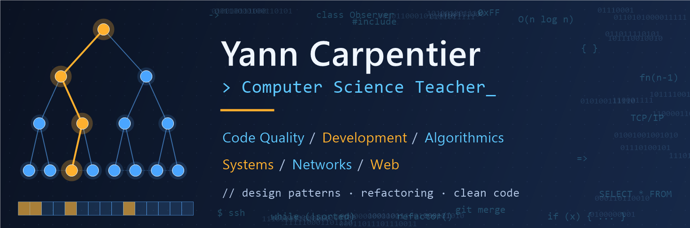

🇫🇷 [Français](README.fr.md) | 🇬🇧 English

#  About me...

My name is Yann Carpentier.

I am a computer science teacher in France, currently working at the [University Institute of Technology of Bayonne](https://www.iutbayonne.univ-pau.fr/).

I teach software development, algorithmics, systems, networks and the web, with a particular focus on code quality (design patterns, refactoring).

## Connect with me

## Some tools I work with

### Languages

  
  
  
  
  
  

### Web

  
  
  
  
  
  
  

### Dev tools

  
  
  
  
  

### Environment

  
  

---
